# 🛡️ PSMM — Supervision de sécurité

> **P**ython · **S**hell · **M**aria**D**B · **M**ail
> Centralisation des protocoles de gestion d'erreurs — infrastructure Debian (+ bonus rsyslog en mode push)

Projet réalisé dans le cadre du **Bachelor IT Cybersécurité** — La Plateforme.

---

## 🎯 Objectifs

Mettre en place un **système de supervision de sécurité** qui :

1. **Collecte** les tentatives d'accès frauduleuses sur les serveurs FTP, SQL et Web (via SSH)
2. **Archive** ces tentatives dans une base de données MariaDB centrale
3. **Alerte** l'administrateur par **mail** et **Google Chat**

Le tout automatisé, planifié et sécurisé.

---

## 🏗️ Architecture

```
                    ┌─────────────────────────┐
                    │      pokemon_client      │
                    │  Poste de supervision    │
                    │  Python · pilote en SSH  │
                    └───────────┬─────────────┘
                                │ SSH (par clé)
          ┌─────────────────────┼─────────────────────┐
          │                     │                     │
   ┌──────▼──────┐       ┌──────▼──────┐       ┌──────▼───────┐
   │ pokemon_ftp │       │ pokemon_web │       │pokemon_mariadb│
   │   vsftpd    │       │Apache+auth  │       │MariaDB · base │
   │             │       │   basic     │       │    psmm       │
   └─────────────┘       └─────────────┘       └───────────────┘
```

- **4 VM Debian 13** sous VMware
- Réseau de la plateforme (bridge Ethernet, portail **Alcasar**)
- Communication **SSH par clé uniquement** entre le client et les serveurs

---

## 🔒 Sécurité

| Mesure | Détail |
|--------|--------|
| **SSH durci** | Mot de passe désactivé · root interdit · seul le compte `monitor` autorisé (`AllowUsers`) |
| **sudo granulaire** | Via `/etc/sudoers.d/` — `NOPASSWD` limité aux seules commandes nécessaires (moindre privilège) |
| **Secrets isolés** | Mots de passe et webhooks dans `.env`, exclu de Git (`.gitignore`) |
| **Identités uniques** | Clés d'hôte SSH et `machine-id` régénérés sur chaque clone |

---

## 📁 Structure du dépôt

```
PSMM/
├── config.py            # Configuration centrale (IP, chemins ; secrets via .env)
├── mailer.py            # Module d'envoi de mail (Gmail/Workspace SMTP)
├── chat_notifier.py     # Module d'envoi Google Chat (webhook)
├── requirements.txt     # Dépendances Python
├── .env.example         # Modèle de configuration des secrets
├── scripts/             # Les livrables (scripts de supervision ssh_*.py)
├── tools/               # Utilitaires de test (génération de fausses tentatives)
├── rsyslog/             # Bonus : configs collecteur / FTP / Web (TLS, nftables)
└── docs/                # Supports de soutenance + captures
```

---

## 🚀 Installation

```bash
python3 -m venv psmm-venv
source psmm-venv/bin/activate
pip install -r requirements.txt
cp .env.example .env      # puis renseigner les secrets
```

---

## 🧩 Les scripts (Jobs)

### Job 01 — 3 serveurs Debian durcis
Création des 3 serveurs (FTP, Web, MariaDB), SSH par clé, root interdit, `monitor` dans le groupe sudo.

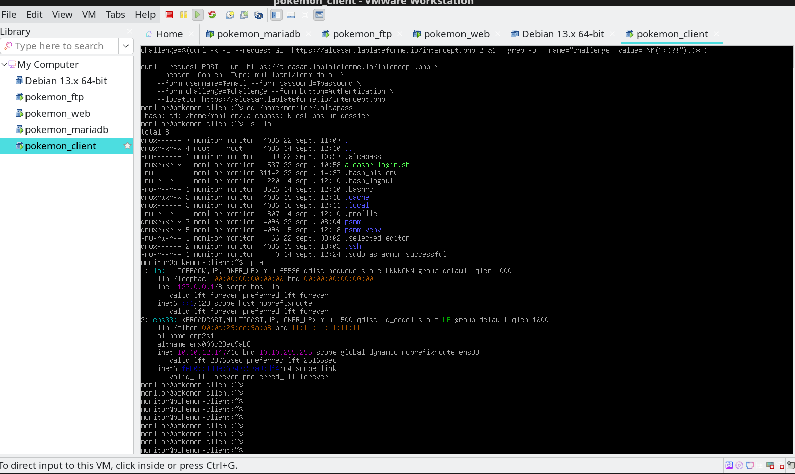
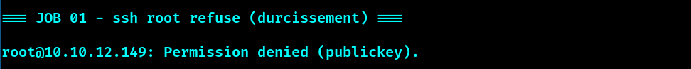

### Job 02 — VM cliente (boîte à outils)
Debian sans GUI · Python + venv · mariadb-client · client FTP · paramiko.

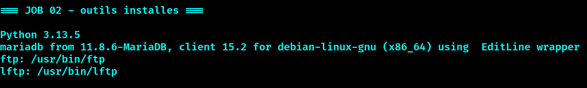

### Job 03 — `ssh_login.py`
Connexion SSH à un serveur et exécution d'une commande shell distante.

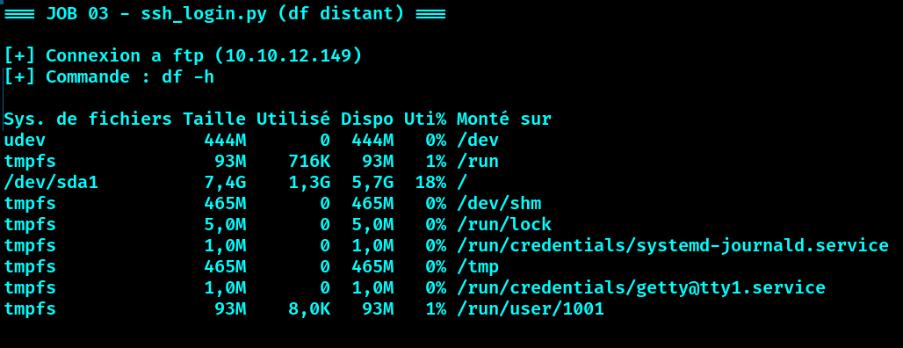

### Job 04 — `ssh_login_sudo.py`
Commande distante en `sudo`, via `sudoers.d` avec NOPASSWD ciblé.

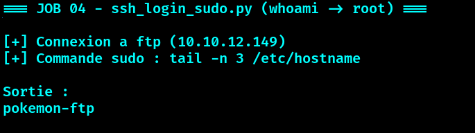

### Job 05 — `ssh_mysql.py`
Vérification de l'accès au serveur MariaDB.

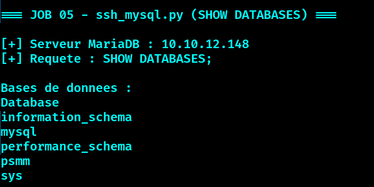

### Job 06 — `ssh_mysql_error.py` (collecte SQL)
Récupération des tentatives d'accès MariaDB échouées → base `psmm.sql_errors`.

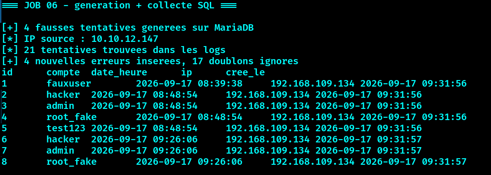

### Job 07 — `ssh_ftp_error.py` (collecte FTP)
Logs vsftpd (PAM) → extraction date/compte/IP → `psmm.ftp_errors`.

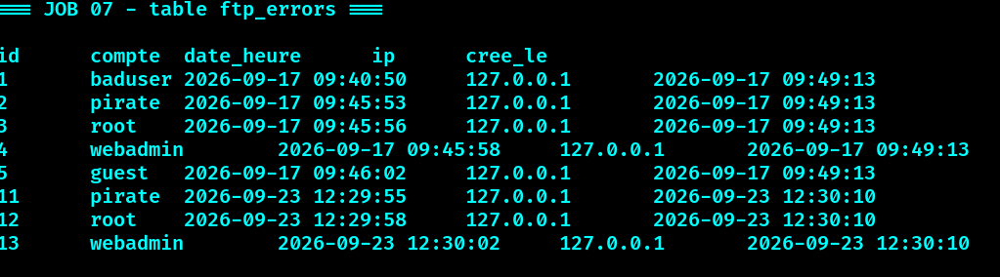

### Job 08 — `ssh_web_error.py` (collecte Web)
Logs Apache (`error.log`) → `psmm.web_errors`.

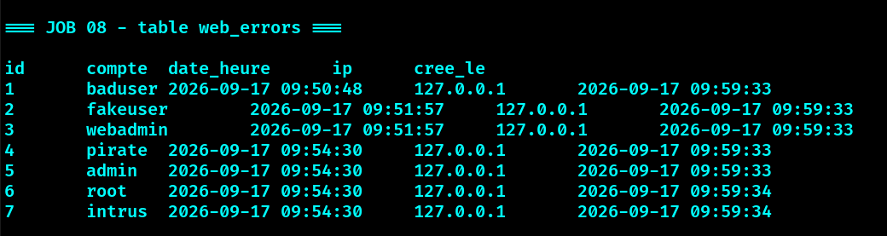

### Job 09 — `ssh_serveur_mail.py`
Rapport mail des tentatives d'accès de la veille à l'administrateur.

### Job 10 — `ssh_cron_backup.py`
Sauvegarde horodatée de la base (rétention 7), planifiée toutes les 3h.

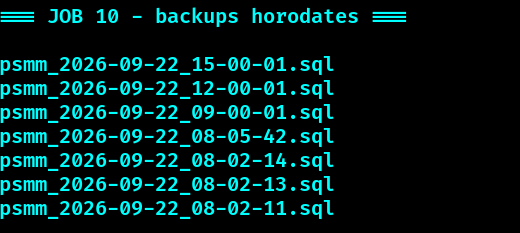

### Job 11 — `ssh_system_status.py`
Relevé CPU/RAM/DISK des 3 serveurs → base (purge > 72h).

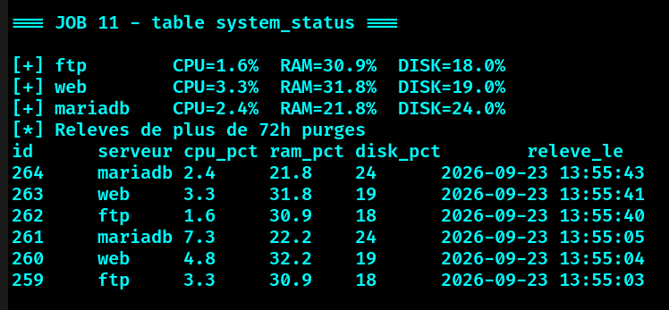

### Job 12 — `ssh_system_mail.py`
Alerte mail si un seuil est dépassé (CPU 70 % · Disque 90 % · RAM 80 %).

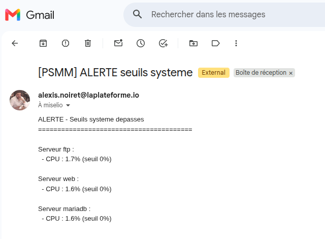

### Job 13 — Anti-spam mail (1/heure)
Au plus un mail par heure à l'administrateur, même en surcharge prolongée.

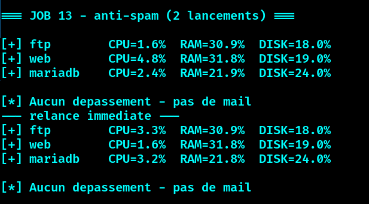

### Job 14 — `ssh_update.py` (mise à jour via Alcasar)
Authentification Alcasar → `apt update/upgrade` → vérification reboot → logout, serveur par serveur.

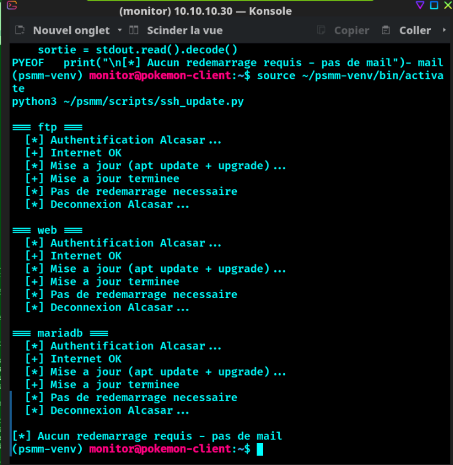

### Job 15 — `ssh_chat.py` (Google Chat)
Rapport quotidien + alerte temps réel des tentatives dans un Space Google Chat.

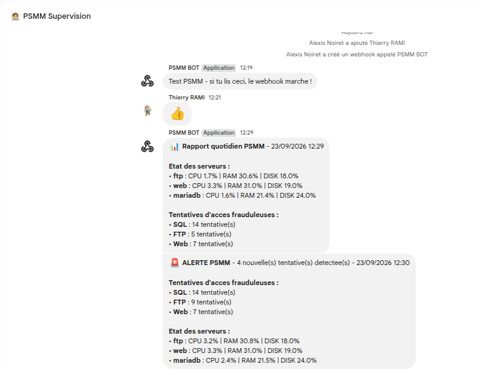

---

## 🚀 Bonus — Collecte en mode PUSH avec rsyslog (Jobs 16 à 21)

Les jobs 1 à 15 fonctionnent en **pull** : le client se connecte en SSH et va chercher les logs (cron). Le bonus passe en **push** : chaque serveur **envoie lui-même** ses échecs d'accès au collecteur (`pokemon_mariadb`) via **rsyslog**, qui les insère en base en temps réel.

| | Pull (Jobs 1-15) | Push (Jobs 16-21) |
|---|---|---|
| Déclencheur | cron toutes les X min | événement (temps réel) |
| Transport | SSH (paramiko) | rsyslog TCP 6514 + TLS |
| Si le collecteur tombe | rien n'est perdu (logs sur place) | spool disque, renvoi automatique |

Configs dans [`rsyslog/`](rsyslog/) (`collecteur/`, `ftp/`, `web/`) — les mots de passe sont remplacés par `VOTRE_MDP_RSYSLOG`.

### Job 16 — Collecteur rsyslog
Le serveur MariaDB écoute en TCP (`imtcp`) et reçoit les logs des autres machines.

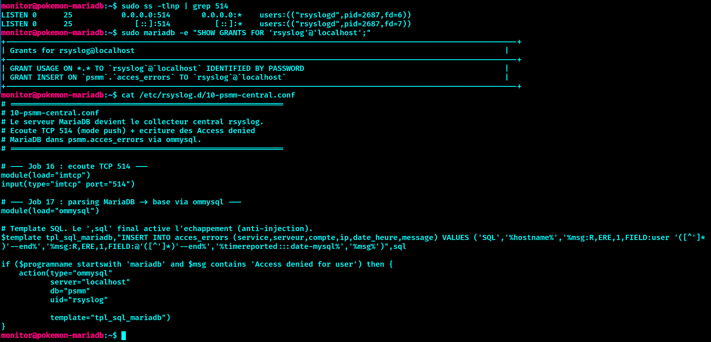

### Job 17 — Parsing MariaDB → base (`ommysql`)
Extraction compte / IP / date des `Access denied` et insertion dans `psmm.acces_errors`. Template SQL avec échappement (anti-injection).

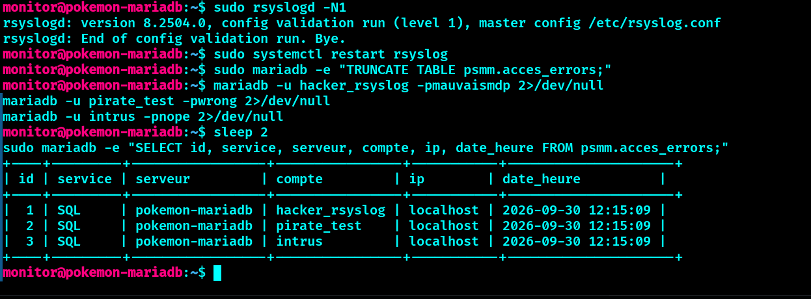
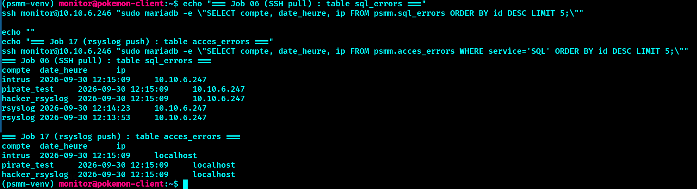

### Job 18 — Push FTP avec spool disque
`imfile` sur `/var/log/vsftpd.log`, envoi `omfwd`, file d'attente sur disque si le collecteur est injoignable.

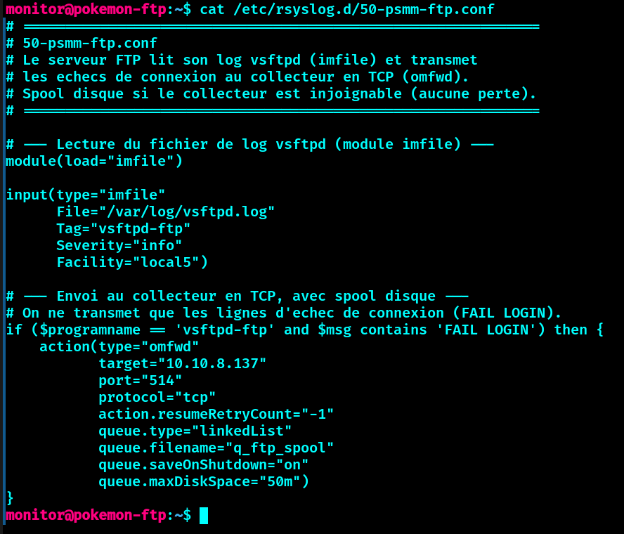
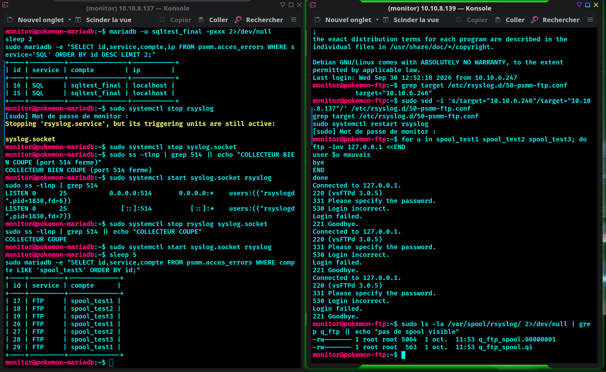

### Job 19 — Push Web (Apache)
Même principe sur `error.log` : filtre des échecs d'auth basic (`AH01617` / `AH01618`).

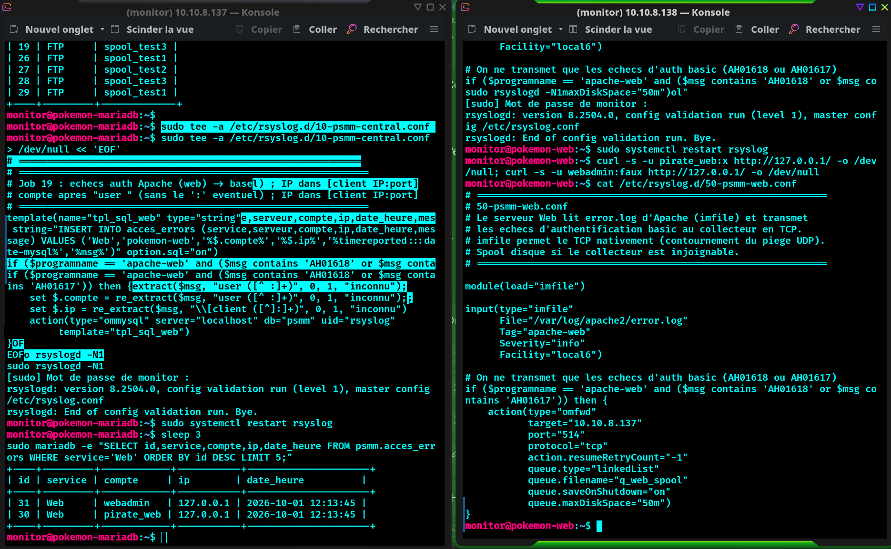

### Job 20 — `rsyslog_mail.py` (mail sans doublons)
Lecture de `acces_errors` avec un compte **SELECT seul** (`psmm_reader`), uniquement les `id` plus récents que le dernier traité (fichier d'état). Rapport SQL / FTP / Web + total. Cron à 7h30.

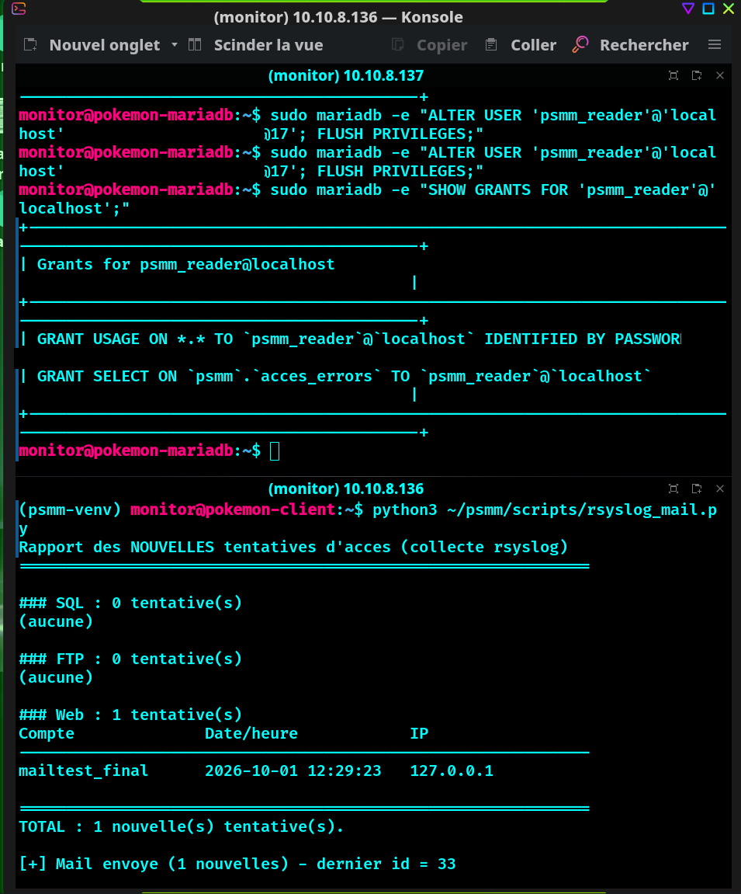
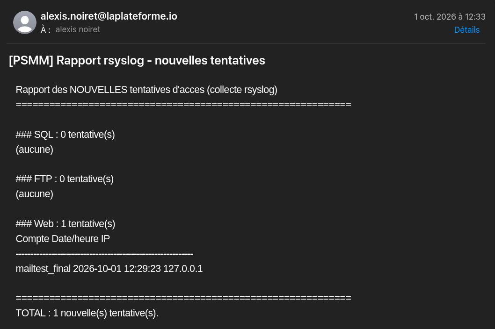

### Job 21 — Sécurisation : TLS mutuel, pare-feu, anti-injection
- **mTLS** (mini-PKI `certtool`, CA + certificat par machine, `x509/name`, port 6514) : seuls `pokemon-ftp` et `pokemon-web` peuvent envoyer
- **nftables** : port 6514 accepté uniquement depuis les IP FTP et Web
- **Anti-injection SQL** : `option.sql="on"` / template `,sql` + compte MariaDB `rsyslog` limité à `INSERT`

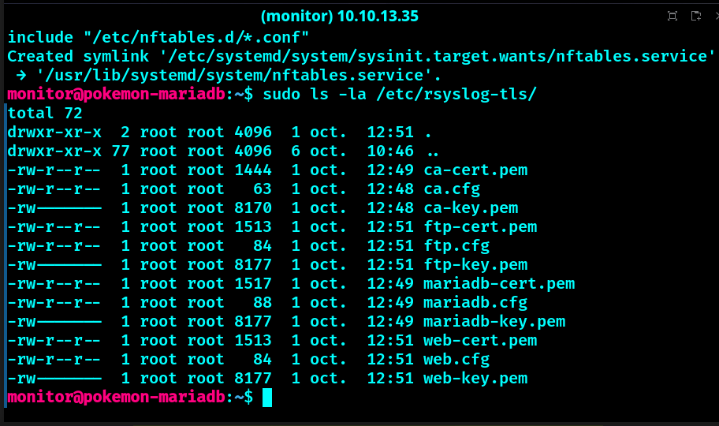
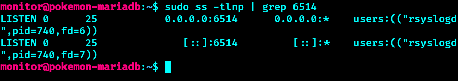
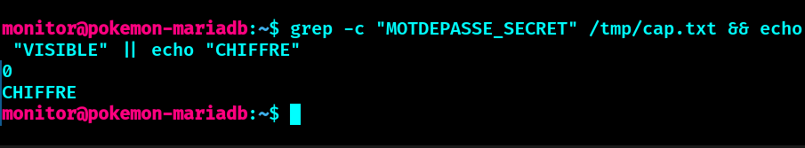
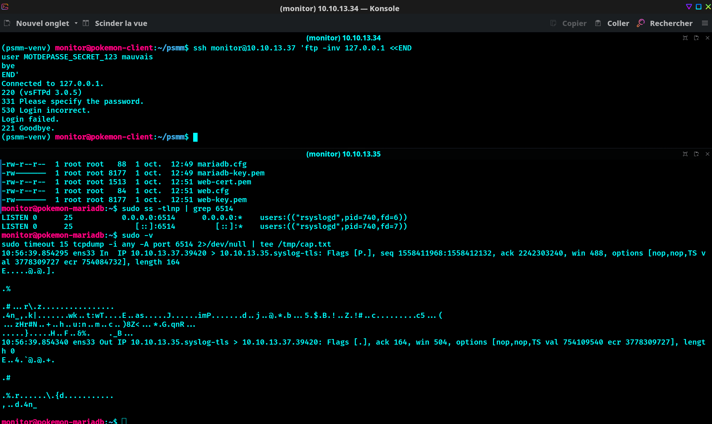
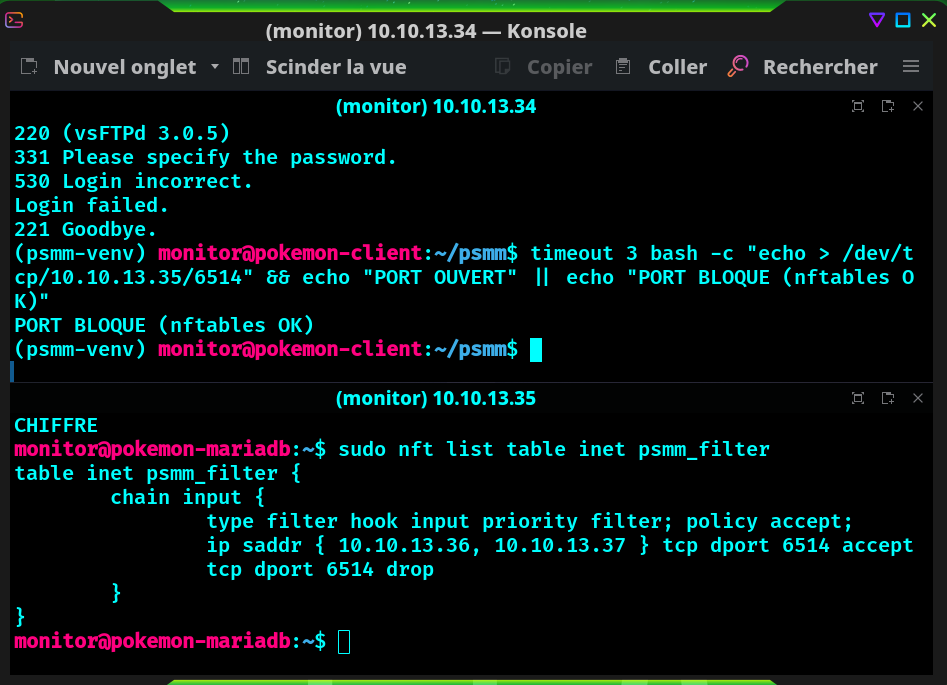
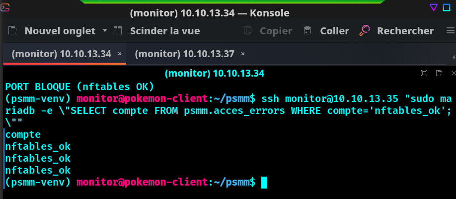
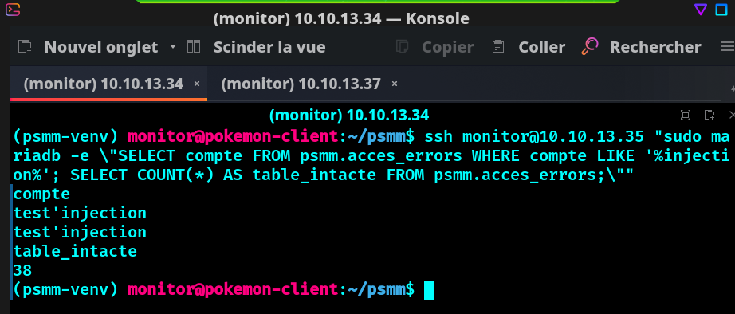

> ⚠️ **Limite connue :** les VM reçoivent une IP DHCP qui change à chaque session. Les `target=` des configs rsyslog (FTP/Web) et `config.py` doivent être mis à jour si les IP changent.

📎 [Diaporama du bonus (PDF)](docs/PSMM_bonus.pdf)

---

## 🚧 Défis techniques surmontés

### Réseau plateforme
En bridge **Wi-Fi**, les VM recevaient une IP mais ne pouvaient pas sortir (ARP `FAILED`).
**Diagnostic :** filtrage MAC du point d'accès. **Solution :** bridge **Ethernet** (pas de filtrage MAC par association).

### Authentification Alcasar
Le portail captif renvoyait une **erreur 411** sur les serveurs.
**Diagnostic :** Alcasar n'autorise qu'**un seul appareil à la fois par compte**.
**Solution :** authentification **séquentielle** (login → update → logout, un serveur après l'autre).

---

## ⏱️ Automatisation (cron)

| Tâche | Fréquence |
|-------|-----------|
| Sauvegarde de la base | toutes les 3h |
| Monitoring + alertes seuils | toutes les 5 min |
| Rapport Google Chat | chaque jour à 8h |
| Surveillance temps réel | toutes les 5 min |

---

## 🧠 Compétences démontrées

- **Scripting Python** : collecte de journaux FTP, SQL et Web sur des serveurs pilotés en SSH.
- **Administration Linux** : 4 VM Debian 13 durcies (SSH par clé, `AllowUsers`, sudo granulaire).
- **Supervision et détection** : repérage des tentatives d'accès frauduleuses et archivage dans MariaDB.
- **Journalisation centralisée** : rsyslog en mode push, parsing vers la base, TLS mutuel (jobs 16 à 21).
- **Alerting** : mails sans doublons et notifications Google Chat.
- **Automatisation** : tâches cron (sauvegardes, monitoring, rapport quotidien).
- **Sécurité** : moindre privilège, secrets isolés dans `.env`, pare-feu, protection contre l'injection.
- **Diagnostic réseau** : filtrage MAC (ARP `FAILED`) et portail captif Alcasar.

---

## 📊 Support de soutenance

📎 [Diaporama de présentation (PDF)](docs/PSMM_soutenance.pdf)  
📎 [Diaporama du bonus rsyslog (PDF)](docs/PSMM_bonus.pdf)

---

## 👤 Auteur

**Alexis Noiret** — Bachelor IT Cybersécurité, La Plateforme (groupe « pokemon »)

- Portfolio : [alexis-noiret.students-laplateforme.io](https://alexis-noiret.students-laplateforme.io)
- GitHub : [github.com/alexis-noiret](https://github.com/alexis-noiret)
